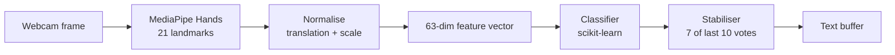

# Real-Time Sign Language to Text Conversion System

Recognise hand signs from a live webcam feed and turn them into text, in real time, on one local machine.

**Status: Phase 0 — planning complete. No code, no dataset, no trained model yet.**
This repository currently contains architecture, configuration and documentation only. See
[`docs/MEMORY.md`](docs/MEMORY.md) for exactly what exists and what does not.

---

## What this is

A B.Tech CSE machine learning project that reads hand landmarks from a webcam using MediaPipe, classifies
them into a small vocabulary of signs with a classical ML model, and composes the recognised signs into
text — all locally, with nothing transmitted anywhere.

The intended vocabulary for v1 is **12 signs plus a neutral rejection class**: HELLO, THANK_YOU, PLEASE,
YES, NO, SORRY, HELP, NAME, WATER, EAT, I_LOVE_YOU, YOU, and `_NEUTRAL`.

**Honest scope.** This is an academic prototype, not an assistive device. It recognises single static
handshapes, not sign language — real sign languages use motion, facial expression, body position and
grammar that this system does not model. The signs are approximations for classification purposes and
have not been validated by a fluent signer.

---

## How it works



The two parts that matter most are the least visible.

**The stabiliser** is why the output is `HELLO` and not `HELLO HELLO HELLO HELLO`. Text is never updated
per frame; a word commits only after 7 of the last 10 frames agree above 80% confidence, and the same
sign will not repeat until the hand passes back through neutral. That deliberate ~1 second of latency is
the difference between a usable system and a stream of noise.

**The grouped split** is why the accuracy figures will be believable. Consecutive video frames are
near-duplicates, so a random train/test split lets the model see almost the same frame on both sides and
produces an inflated score. Splits here are grouped by recording session, and the project reports the
random score alongside the grouped one to quantify exactly how much that would have flattered us. This is
covered in detail in [`docs/DATASET.md`](docs/DATASET.md) §9 — it is the part most worth reading.

---

## Technology

Python 3.10/3.11 · OpenCV (capture) · MediaPipe Hands (landmarks) · NumPy + pandas · scikit-learn
(classification, comparing six candidates) · joblib · PyYAML · matplotlib + seaborn (figures) ·
CustomTkinter + Pillow (desktop UI) · pytest.

No TensorFlow, no PyTorch, no GPU. MediaPipe is itself a pre-trained deep network, used as a **frozen
feature extractor** — so this is transfer learning with a classical head, and
[`docs/MODEL.md`](docs/MODEL.md) §3.5 says so rather than claiming to have avoided deep learning.

---

## Quick start

> Nothing below has been run yet. Version pins are unverified — Phase 1 exists to verify them.
> Full procedure in [`docs/DEPLOYMENT.md`](docs/DEPLOYMENT.md).

```bat
python -m venv .venv
.venv\Scripts\activate
pip install -r requirements.txt
pip install -e .
python scripts\check_camera.py
```

Requires Python **3.10 or 3.11** — MediaPipe 0.10.x publishes no wheels for 3.12+ — and on Windows, the
python.org installer's "tcl/tk and IDLE" option must be checked, or the UI cannot import.

Then, in order:

```bat
python scripts\collect_data.py --class HELLO --signer HT --session 1   :: repeat per class/session
python scripts\build_dataset.py
python scripts\train_model.py
python scripts\evaluate_model.py
python app.py
```

**A fresh clone cannot recognise signs.** No dataset and no model are included — the dataset is video of
people's hands and is deliberately not committed. You must collect your own data and train. The app
launches and shows a guidance screen explaining this rather than crashing.

---

## Configuration

Everything tunable lives in [`config.yaml`](config.yaml) — the single source of truth. Class list,
camera settings, feature options, split strategy, model candidates and grids, confidence threshold,
stabiliser parameters, UI palette, paths, random seed.

**No behavioural constant is hard-coded in source.** If you want a different confidence threshold, a
different vocabulary, or a different colour scheme, you edit config, not code. If this README and
`config.yaml` ever disagree, config is correct.

Adding a new sign is a config change plus data collection — no source rewrite. Checklist in
[`docs/DATASET.md`](docs/DATASET.md) §14.

---

## Privacy

Camera frames are processed in-process and **never transmitted**. There is no HTTP client, no telemetry
and no analytics anywhere in `src/` — not disabled by a setting, simply absent, which is a stronger
guarantee than a promise and can be verified by grepping the source.

The camera opens only on explicit request and is released on stop and on window close. The dataset
contains hand landmarks plus sparsely sampled debug images, stored locally at documented paths, and is
excluded from git. Only signer initials are recorded — no names.

**One unresolved issue, stated plainly:** this project directory sits inside OneDrive, so the dataset
would be synchronised to Microsoft's cloud. Until that is resolved (open question OQ-06), the claim
"video never leaves this machine" is aspirational rather than true. See
[`docs/DEPLOYMENT.md`](docs/DEPLOYMENT.md) §7.1.

---

## Documentation

| Document | What is in it |
|---|---|
| [`docs/PRD.md`](docs/PRD.md) | Requirements, user stories, acceptance criteria, risks, limitations, open questions |
| [`docs/ARCHITECTURE.md`](docs/ARCHITECTURE.md) | System design, module boundaries, diagrams, 14 ADRs, error-handling matrix |
| [`docs/DATASET.md`](docs/DATASET.md) | Storage decision, vocabulary, schema, collection runbook, **the leakage analysis** |
| [`docs/MODEL.md`](docs/MODEL.md) | Option A vs B, normalisation chain, six candidates, evaluation protocols, stabilisation |
| [`docs/DESIGN.md`](docs/DESIGN.md) | UI/UX: layout, palette, components, every loading/empty/error state, accessibility |
| [`docs/PHASES.md`](docs/PHASES.md) | 16-phase roadmap, ownership, 6-week calendar, descoping plan, 52-question viva bank |
| [`docs/TESTING.md`](docs/TESTING.md) | Test strategy, fixtures, the tests that protect scientific validity, coverage targets |
| [`docs/DEPLOYMENT.md`](docs/DEPLOYMENT.md) | Setup, run order, model versioning, git policy, reproducibility |
| [`docs/TROUBLESHOOTING.md`](docs/TROUBLESHOOTING.md) | Diagnostic decision tree and failure catalogue |
| [`docs/RULES.md`](docs/RULES.md) | Enforceable engineering rules for this codebase |
| [`docs/MEMORY.md`](docs/MEMORY.md) | **Read this first** — current state, all decisions, all measured results |

---

## Results

**No results exist yet.** No data has been collected, no model trained, no measurement taken.

Targets were declared in advance, before any data existed, so they cannot be quietly adjusted afterwards:
macro-F1 ≥ 0.85 target and ≥ 0.75 minimum on grouped cross-validation, per-class recall ≥ 0.70,
`_NEUTRAL` recall ≥ 0.90, ≥ 15 FPS end-to-end, inference p95 ≤ 50 ms.

Measured values land in [`docs/MEMORY.md`](docs/MEMORY.md) §5 at Phases 7 and 13. Until then every entry
reads `TBD`. If the accuracy floor is missed, the documented response is to reduce the vocabulary and
report honest numbers, not to switch to a more flattering evaluation protocol.

---

## Project layout

```text
sign-language-to-text/
├── app.py                  # desktop application entry point
├── config.yaml             # single source of truth
├── src/sign_language/
│   ├── config/             # schema + loader
│   ├── core/               # camera, hand detector, shared types
│   ├── data_collection/    # collector, session handling, validation
│   ├── features/           # normaliser, extractor, registry
│   ├── preprocessing/      # dataset builder, grouped splitter
│   ├── training/           # candidates, tuning, trainer, evaluation
│   ├── inference/          # predictor, stabiliser, pipeline
│   ├── text/               # text composer
│   ├── ui/                 # theme, OpenCV HUD, CustomTkinter app
│   └── utils/              # paths, logging, seeding, exceptions
├── scripts/                # collect_data, build_dataset, train_model, evaluate_model, run_realtime, benchmark
├── tests/                  # unit, integration, model
├── data/                   # raw, interim, processed, features, metadata  (git-ignored)
├── models/v1/              # binaries git-ignored; model_metadata.json committed
├── reports/                # figures, metrics
└── docs/                   # the 11 documents above
```

UI never contains ML logic, and `inference/` never imports `ui/` — enforced by a test.

---

## Team

Three-member B.Tech CSE project. Names and roll numbers are recorded in
[`docs/PRD.md`](docs/PRD.md) §1 only — deliberately kept out of configuration and source so that no
runtime code path handles personal information.

---

## Licence and intent

Academic coursework. Not licensed for production or assistive use. Not a medical or accessibility device.
